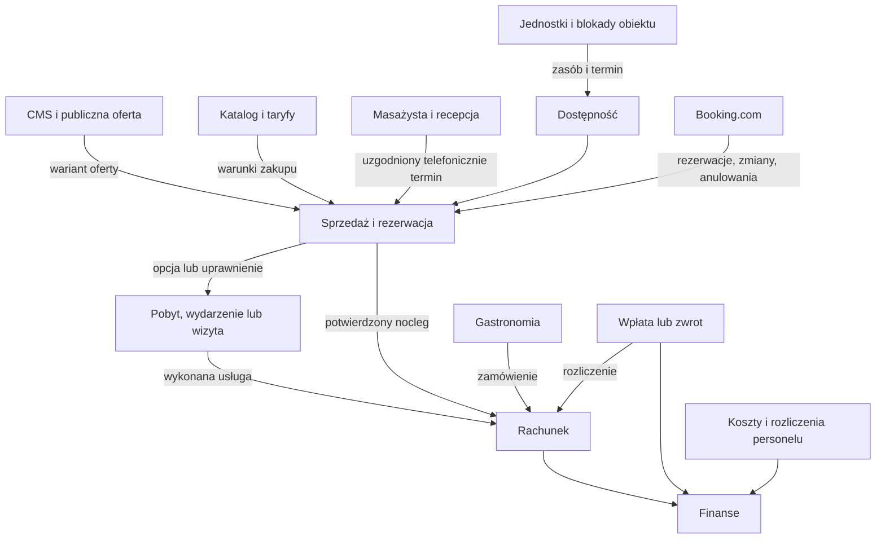

# Przepływ informacji i decyzji w rivé

**Confirmed.** Reguły poniżej pochodzą z [wywiadów](../discovery.md), [recepcji](../product/reception-discovery.md) i [kart pytań i rozstrzygnięć D-01–13](../product/open-questions.md). Numery odnoszą się do [15 obszarów](../product/capability-map.md). **Proposed.** Strzałki pokazują przekazanie odpowiedzialności biznesowej. Nie przesądzają liczby aplikacji, usług ani baz. Ostatnia kolumna zawiera propozycje prób. Pytania wymagające decyzji pozostają otwarte.

| Przebieg i obszary | Ustalone zachowanie i granica odpowiedzialności | Przypadek rozstrzygający lub luka |
| --- | --- | --- |
| **Nocleg** · 01, 02, 03, 06, 10, 11, 13 | Gość wybiera typ. Formularz zajmuje miejsce w puli. Zaliczka 30% obejmuje pakiet. Szybka płatność ma termin 2 h, przelew 24 h, dla przyjazdu dziś WWW oferuje szybką płatność. Recepcja może potwierdzić telefonicznie bez zaliczki. Potwierdzenie dodaje cenę do rachunku, wpłata pomniejsza saldo. Recepcja przydziela jednostkę. | Wygasła blokada i spóźniony przelew po sprzedaży miejsca prowadzą do sprawy dla recepcji. Zachować obie rezerwacje przy konflikcie z OTA i wykluczyć nakładające się fizyczne przydziały. Otwarta granica przelewu dla przyjazdu jutro oraz ujęcie przychodu. |
| **Day SPA** · 01, 03, 04, 06 | WWW pokazuje dzień z dostępnym przedziałem dla co najmniej jednej osoby. Recepcja umawia grupę telefonicznie. Akcja „Wejście” rejestruje obecność. System prognozuje 3 h przy przyjęciu bez rezerwacji i przedłuża prognozę co 30 minut do zamknięcia. Wyjście kończy naliczanie za osobę. | Grupa przychodzi częściami. Przy chwilowym wyjściu recepcja wstrzymuje naliczanie i odkłada miejsce do planowanego końca. Prognoza, odłożone miejsce i czas płatny mają inne znaczenie. Przy kolizji jedno ostrzeżenie wskazuje brakujące miejsca. Recepcja może zaakceptować przekroczenie prognozy, uwzględniając potwierdzone wejścia. |
| **Nocleg z pakietem / retreat** · 02, 03, 04 | Pakiet całopobytowy daje dostęp bez wcześniejszego odkładania miejsc. Wariant jednorazowy odkłada miejsce po uzgodnieniu pory. Przy dużym obłożeniu recepcja zarządza wejściem. | Dla retreatu z zajęciami przygotować dwa warianty oferty: wszystkie terminy zagwarantowane przy zakupie albo zajęcia umawiane później. Właściciel decyduje, co wolno obiecać przed sprzedażą. |
| **Voucher** · 02, 04, 06, 10, 11 | WWW i recepcja sprzedają ze wspólnej oferty. Kupiony voucher zachowuje warunki, kwotowy można realizować częściami. Nabywca może różnić się od osoby korzystającej. | Dwie równoczesne realizacje nie zużywają dwa razy tego samego salda. Uzgodnić anulowanie realizacji i przypadek pozostałego salda po terminie oraz dokumenty przy sprzedaży i realizacji. |
| **Wydarzenie** · 01, 03, 04, 05, 10 | Kupujący otrzymuje potwierdzenie biletu. Wydarzenie ma limit i może ograniczyć nowe rezerwacje SPA. Dotychczasowe rezerwacje pozostają ważne. Odwołanie wymaga indywidualnego uzgodnienia. | Ostatni bilet, kilku uczestników, zmiana liczebności i przeniesienie opłaconego zakupu. Potrzeba listy imiennej i danych uczestnika wymaga wskazania celu. |
| **Zabieg** · 03, 04, 06, 08 | Recepcja ustala telefonicznie termin z gościem i uzgadnia dostępność z masażystą. Pracownik oznacza wykonanie. System dopisuje cenę do otwartego rachunku. | Terapeuta choruje po umówieniu terminu. Kto kontaktuje się z gościem? Przy powtórzeniu oznaczenia jedna usługa ma jedną pozycję. Rozstrzygnąć brak otwartego rachunku. |
| **Gastronomia** · 05, 06, 07, 10, 12 | Telefon, nazwisko lub numer jednostki wskazuje kandydatów do dopisania zamówienia. Gastronomia widzi własne pozycje i ich status. Może przyjąć wpłatę od razu i poprawić przypisanie opłaconej pozycji do otwartego rachunku. Faktyczny płatnik pozostaje zapisany. | Dwa podobne wyniki wyszukiwania oraz zamknięcie rachunku podczas dopisywania. Określić minimum danych do rozróżnienia gości i odbiorcę korekty po zamknięciu. |
| **Publikacja i sprzedaż** · 01, 02, 03, 05 | Redaktor z uprawnieniem publikuje po podglądzie. Strona prowadzi do zakupu noclegu lub kontaktu dla SPA. Formularz kontaktowy kieruje na wspólną skrzynkę recepcji. | Zmiana opisu nie modyfikuje zakupionej oferty. Sprawdzić przejście z konkretnej oferty do kalendarza i osobno uznanie wpłaty. Kliknięcie „Zadzwoń” mierzy zamiar. |
| **Od operacji do wyniku** · 06, 07, 10, 11 | Rozróżnić wykonaną usługę, należność, alokację, rzeczywistego płatnika, zwrot i dokument. Wymeldowanie może pozostawić rachunek otwarty. Raport metod służy do porównania w razie potrzeby. | Przykład syntetyczny: nocleg 1000, zaliczka 300, gastronomia 80 zapłacona od razu → pozostało 700. Rachunek domyślnie należy do rezerwującego. Recepcja może alokować zaliczkę na saldo grupy lub wskazanej osoby. Zmiana alokacji zachowuje faktycznego płatnika i nie podnosi sprzedaży. Data wyniku, podatki i podział kosztów pakietu wymagają uzgodnienia. |
| **Personel** · 08, 11, 12 | Plan zmiany, dostępność masażysty i faktycznie przepracowany czas to różne dane. Pracownik poprawia własny wpis także po zamknięciu okresu. System zachowuje historię i informuje kierownika. | Zmiana przez północ i korekta po wyliczeniu wynagrodzeń. Ustalić okres i odbiorcę korekty bez komplikowania codziennego „Rozpocznij/Zakończ”. |

**Obiekt, migracja i ciągłość obsługi · 09, 14, 15.** Przy ewentualnej migracji właściciel uzgadnia przyszłe rezerwacje, otwarte rachunki z wpłatami i ważne niewykorzystane vouchery. [Próby migracji i odtworzenia](quality-and-recovery.md)

Po wymeldowaniu jednostka trafia do sprzątania. Najbliższy przyjazd ustala kolejność na wspólnej liście. Status sprzątania daje ostrzeżenie przy zameldowaniu. Osobna blokada techniczna ma tryb zakończenia wybierany przez recepcję. Przy odtwarzaniu po awarii uwzględnić blokady, faktyczne wejścia, otwarte rachunki i wpłaty między ostatnią kopią a przywróceniem obsługi. [Ustalenia obiektu](../discovery.md#gotowość-noclegu--2026-11-20)

## Co zachować i gdzie integrować

**Confirmed — obserwacja źródeł, 2026-11-25.** Cezar daje punkt odniesienia dla kalendarza, stawek godzinowych, list operacyjnych, raportów i kontaktu telefonicznego. Widoczny ekran raportu nie potwierdza wzoru ani kompletności eksportu. Z audytu publicznej strony zachować jako próby regresji m.in. poprawny adres HTTPS na ścieżce sprzedaży, tekstową cenę i zachowanie kontekstu wybranego noclegu. [Pokrycie panelu](../audits/cezar/dashboard/coverage-and-gaps.md) · [Problemy strony](../audits/cezar/public-web/issues.md)

| Wzorzec u dostawcy | Proposed — do czego użyć porównania | Co warunkuje zakup lub własną realizację |
| --- | --- | --- |
| Sesje wellness, wejścia dzienne i limity | Zestawić sesję o stałym początku z dowolnym faktycznym wejściem, przerwą i dopłatą minutową rivé. [Clock](https://www.clock-software.com/who-its-for/wellness-activity-retreats) · [Trybe](https://try.be/bathhouses) | Jeżeli konfiguracja wymaga czynności przy każdym przedłużeniu, własna obsługa obecności ma przewagę operacyjną. Zweryfikować na scenariuszu, przed zakupem. |
| POS hotelowy i dopisywanie zamówień | Sprawdzić gościa dziennego bez pokoju i przeniesienie pozycji po zapłacie z zachowaniem płatnika. [POSbistro](https://posbistro.com/typ-biznesu/oprogramowanie-dla-restauracji-hotelowej/) | Porównać konfigurację dostawcy z adapterem do rachunku rivé. Powtórzenie i korekta wymagają sprawdzalnego wyniku. |
| Gotowość jednostki i przydział | Odróżnić możliwość sprzedaży, wydania oraz stan sprzątania w teście awarii jednostki z rezerwacją. [Oracle OPERA](https://docs.oracle.com/en/industries/hospitality/opera-cloud/23.1/ocsuh/t_housekeeping_using_the_housekeeping_board.htm) | Nadmiar statusów zwiększa pracę. Punktem odniesienia jest ustalona wspólna lista rivé. |
| Rezerwacje z kanału i dostawa zastępcza | Powtórzenie lub dostarczenie komunikatu po ręcznej obsłudze powiadomienia ma wskazać tę samą rezerwację. [Booking.com Connectivity](https://developers.booking.com/connectivity/docs/reservations-api/reservations-overview) | Na start recepcja ręcznie aktualizuje ceny i pulę na Booking.com. Sprawdzić dostęp partnera lub pośrednika, zakres, eksport i koszt. Dokumentacja producenta nie potwierdza uprawnień rivé. |

Wariant własny, zakup i hybrydę porównać na dotychczasowym [skrypcie demonstracji](hotel-spa-benchmark.md). Odłożone rozszerzenia to m.in. samoobsługa Day SPA, kolejne kanały i docelowe wyposażenie jednostek. Potrzeba portalu, pełnego CRM i oddzielnego narzędzia marketingowego zależy od rzeczywistych czynności gościa i personelu.

## Od zaliczki do wyniku gałęzi

**Proposed — materiał do D-09, druga sesja 2026-11-25.** Wszystkie liczby poniżej są syntetyczne, w tej samej umownej jednostce. Przykład izoluje zależności zarządcze. Księgowość musi ustalić podstawę kwot, podatki, dokumenty i moment ujęcia dla rivé.

Właściciel może potrzebować trzech różnych odpowiedzi w tym samym dniu. **Sprzedaż zarezerwowana** pokazuje zamówienia zaakceptowane przez gości oraz ich późniejsze zmiany. **Wartość wykonanych świadczeń** odpowiada na pytanie, co obiekt dostarczył w danym okresie. **Wpływy i wypłaty** pokazują pieniądze od gości i zwroty. Pełny przepływ pieniężny firmy wymaga jeszcze wydatków i innych przepływów. Saldo konkretnego rachunku oraz wartość niewykorzystanych voucherów wyjaśniają, dlaczego liczby różnią się między sobą.

| Okres i zdarzenie | Wpłaty od gości | Zwroty wykonane | Wykonanie i korekty wg wariantu bieżącego | Stan na koniec |
| --- | ---: | ---: | ---: | --- |
| XI. Zakup pakietu za 900, zaliczka 270. Osobno kupiono voucher kwotowy za 200. | 470 | 0 | 0 | Do dopłaty za pobyt 630. Na voucherze 200. |
| XII. Wykonano pakiet, przyjęto dopłatę 630 i zapłatę za gastronomię 80. Osobna usługa SPA za 120 opłacona voucherem. | 710 | 0 | 1100 | Pobyt rozliczony. Na voucherze 80. |
| I. Uznano obniżkę ceny grudniowej gastronomii o 20, następnie wykonano zwrot. | 0 | 20 | −20 | Między uznaniem a wypłatą jest 20 do zwrotu. Po wypłacie saldo rozliczenia 0. |
| Razem | 1180 | 20 | 1080 | Wpływy po zwrocie 1160. W tym przykładzie różnica 80 odpowiada pozostałemu saldu vouchera. |

**Przypisanie do gałęzi.** Przykładowe ceny osobne dwóch świadczeń to 800 za nocleg oraz 200 za usługę SPA. Rozdzielenie ceny pakietu 900 w tej proporcji daje 720 i 180. W grudniu noclegi wykazują 720, SPA 300 (180 + 120), gastronomia 80. Po styczniowej korekcie gastronomia ma 60 narastająco. Alternatywa przy braku wiarygodnych cen osobnych: wydzielić gałąź „Pakiety” i pokazać wykorzystanie jej świadczeń ilościowo. Oba widoki wymagają kontroli, czy suma części jest równa cenie transakcji. Alokacja ceny na działy ma inny cel niż podział rachunku między płatników.

**Granica miesiąca.** Jeżeli dwie równo wycenione noce przekraczają koniec okresu, proponowany rozkład części noclegowej to 360 na każdą noc. Uzgodniona pojedyncza usługa SPA ma osobną datę wykonania. Dla pakietu dającego dostęp przez cały pobyt właściciel musi określić, czy świadczenie polega na zapewnieniu dostępu w danych dniach. Liczba wejść może wtedy służyć do analizy wykorzystania, a nie do automatycznego podziału wartości.

**Koszty i rentowność.** Bezpośredniość mówi, czy koszt da się przypisać do gałęzi. Zmienność mówi, czy zmienia się z liczbą świadczeń. Wynagrodzenie stałe przypisane wyłącznie gastronomii może być bezpośrednie i stałe. W przykładzie wszystkie koszty zmienne sumują się do 300 i są bezpośrednie, a wspólne 240 to w całości koszty stałe. Koszty zmienne gałęzi: noclegi 180, SPA 90, gastronomia 30. Marże pokrycia po korekcie wynoszą odpowiednio 540, 210 i 30. Razem 780. Po odjęciu 240 kosztów wspólnych zostaje 540 nadwyżki po uwzględnionych kosztach. Jeśli występuje także zmienny koszt wspólny, odejmujemy go przy liczeniu łącznej marży pokrycia. Brak danych o koszcie oznaczamy jawnie. Propozycja dla właściciela: najpierw pokazać wynik działu po jego własnych kosztach oraz wspólne koszty na poziomie obiektu. Jeśli potrzebny pełen wynik działu, uzgodnić mierzalny klucz, np. godziny pracy przy sprzątaniu, datę jego obowiązywania i kwotę nieprzypisaną. Koszt odjęty w dziale nie może zostać ponownie odjęty w podsumowaniu.

**Korekta okresu.** W wariancie bieżącym grudniowy wynik wykonania pozostaje 1100, a w styczniu pojawia się −20 z odniesieniem do grudnia. Wariant porównawczy przelicza grudzień do 1080 i pozostawia styczniowe wykonanie 0. W obu wariantach pieniądze wychodzą w styczniu. Wybór zmienia porównywalność raportów historycznych; raport powinien wskazać zastosowaną politykę i datę aktualności. Zwrot samej zaliczki przy braku wykonania dotyczy pieniędzy i rozliczenia zobowiązania. Ponowienie importu, zmiana płatnika lub wystawienie dokumentu nie mogą ponownie doliczyć usługi.

**Uzgodnienie z księgowością.** Dla jednego okresu przejść od kwoty w raporcie do świadczenia, pozycji rachunku, wpłaty/zwrotu, potwierdzenia operatora i powiązanego dokumentu. Dla kosztów wskazać źródło, okres, gałąź i podstawę alokacji. Rozbieżności rozdzielić na przesunięcie dat, opłatę operatora, brak dokumentu, różnicę podatkową i niewyjaśnioną pozycję. Wypłata operatora po potrąceniu prowizji nie musi być równa sumie wpłat klientów. Księgowość kwalifikuje dokumenty i daty formalne. Właściciel wybiera sposób porównywania działalności. Recepcja korzysta z zapisanych zdarzeń bez dodatkowego obowiązku zamknięcia raportu. [Wpłaty i dokumenty](../product/open-questions.md#d-08) · [Finanse](../product/open-questions.md#d-09)

**Kontrola metod.** Gotówkę porównać z kasą, zwykły przelew z wyciągiem, kartę na miejscu z ręcznym potwierdzeniem wyniku terminala, płatność internetową z potwierdzeniem operatora. Oddzielny przykład poza kalkulacją kosztów powyżej: gość płaci 80, operator potrąca 2 prowizji i przelewa 78 na konto obiektu w kolejnym okresie. W raporcie wpłat gości występuje raz 80. W uzgodnieniu operatora i banku występują kwota rozrachunku, prowizja i data wpływu. Jedna wpłata może pokryć kilka świadczeń, a jedna usługa może być rozliczona kilkoma metodami.
